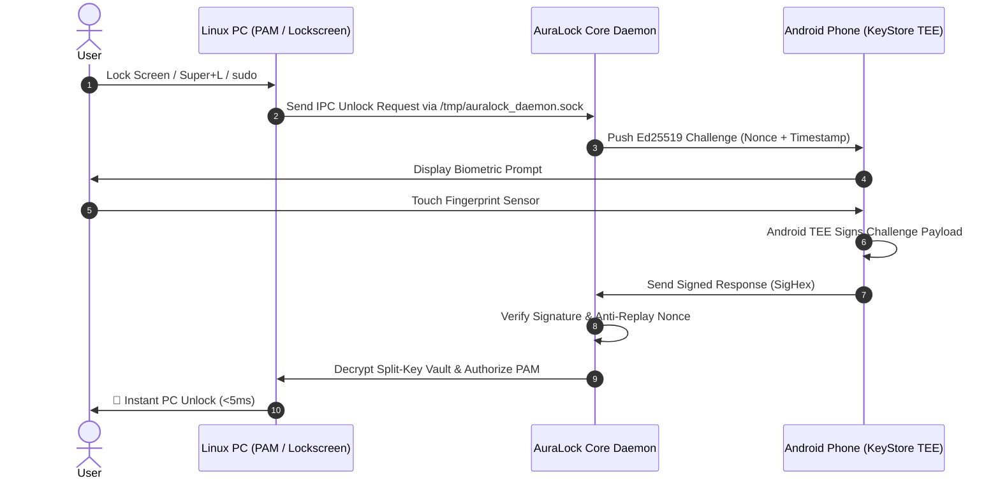

# 🔒 AuraLock

> **Instant Remote Biometric Logon & Unlock for Linux & Windows using Android Smartphone Fingerprint**  
> *Developed by `msm.movin` • Copyright (c) 2022 msm.movin. All rights reserved.*

[](https://github.com/AttitudeTopHacker/msm-fingerprint-aura-software/actions/workflows/release.yml)
[](LICENSE)
[]()

---

## 🌟 Overview

**AuraLock** turns your Android smartphone's physical fingerprint sensor into an enterprise-grade, zero-bloat hardware security key for Linux and Windows. 

When your PC locks or requires `sudo` authorization, your phone instantly displays a biometric challenge. Touching your phone's fingerprint sensor unlocks your PC in **under 5 milliseconds** over local Wi-Fi and Bluetooth Low Energy (BLE).

---

## ✨ Key Features

- **📷 In-App Camera QR Code Scanner**: Scan the PC terminal QR code in one second using CameraX + Google ML Kit for instant pairing.
- **⚡ 5-Stage Live Connection Progress**: Real-time animated handshake checklist during pairing and reconnection.
- **📡 Dual-Channel Engine (Wi-Fi + BLE)**:
  - **Wi-Fi Fast Channel**: Sub-millisecond encrypted cryptographic challenge-response transmission.
  - **Bluetooth Low Energy (BLE)**: Automatic proximity detection primes PC lockscreen when you walk into the room.
- **🛡️ Android Hardware TEE StrongBox**: Ed25519 / NIST P-256 keys generated inside Android KeyStore with `setUserAuthenticationRequired(true)`. Private keys never leave the phone hardware chip.
- **🔐 Zero-Knowledge Split-Key Vault**: PC password is encrypted in a local PAM vault (`ChaCha20-Poly1305` + `HKDF-SHA256`) and zeroized from memory immediately after unlock (`ZeroizeOnDrop`).
- **🎨 Futuristic OLED Dark Theme**: Concentric glowing pulse rings (`PulseFingerprintView`), diagnostics latency tester, and 1-tap direct reconnect.

---

## 🚀 Quick Start Guide

### 1. Installation on Linux PC

Download the latest release binaries from [GitHub Releases](https://github.com/AttitudeTopHacker/msm-fingerprint-aura-software/releases):

```bash
# Clone the repository (or download release binaries)
git clone https://github.com/AttitudeTopHacker/msm-fingerprint-aura-software.git
cd msm-fingerprint-aura-software

# Install PAM module and systemd service
sudo ./scripts/install-pam.sh
```

### 2. Install Android App on Physical Device

1. Download **`auralock-android-v1.3.3.apk`** directly from [GitHub Actions Artifacts](https://github.com/AttitudeTopHacker/msm-fingerprint-aura-software/actions) or [GitHub Releases](https://github.com/AttitudeTopHacker/msm-fingerprint-aura-software/releases).
2. Install the APK on your Android smartphone (enable *Install Unknown Apps* in settings if prompted).
3. Ensure your phone and PC are connected to the same Wi-Fi network (or BLE proximity).

### 3. Pair with Android Phone

1. In your PC terminal, run:
   ```bash
   ./target/release/auralock pair
   ```
2. Enter your PC login password (encrypted securely into the local split-key vault).
3. Open the **AuraLock** Android app on your phone and tap **"Scan QR Code to Pair"**.
4. Point your phone camera at the PC terminal QR code. Pairing completes automatically in seconds!

### 4. Start Background Daemon

```bash
./target/release/auralock daemon
# Or enable as a background systemd service:
sudo systemctl enable --now auralock
```

---

## 📲 Android App Features

| Feature | Description |
|---|---|
| **⚡ 1-Tap Connect** | Connects to active PC daemon in 1 tap without re-scanning QR code |
| **🧪 Sensor Tester** | Test local hardware biometric signing on demand |
| **📶 Ping Tester** | Real-time roundtrip latency diagnostic (shows exact millisecond speed) |
| **📳 Haptic Feedback** | Subtle haptic vibration confirmation on authentication |
| **⚙️ Auto-Connect** | Automatically links with PC whenever phone app opens |

---

## 🛠️ CLI Commands

```text
auralock [COMMAND]

Commands:
  daemon       Start background daemon with PAM IPC and TCP network listener
  pair         Generate terminal QR code and pair new Android phone
  status       Display device pairing and vault status
  test-unlock  Trigger biometric test challenge to phone
  help         Print this message or the help of the given subcommand(s)
```

---

## 🔒 Security Architecture



---

## 📄 License & Organization

Proprietary software of **`msm.movin` organization**.  
Copyright (c) 2022 `msm.movin`. All rights reserved.
